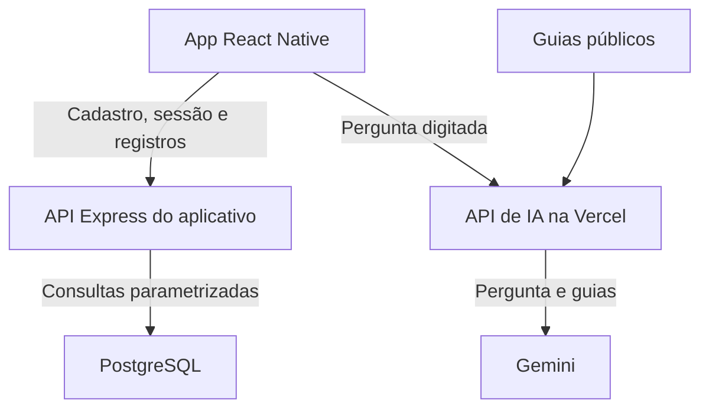

# Entrelinhas — documentação do aplicativo

## 1. Apresentação e funcionalidades

O Entrelinhas é um diário de humor para adultos que desejam observar como se sentem ao longo do tempo e registrar situações do cotidiano. O aplicativo foi desenvolvido em React Native para o Trabalho Final de Desenvolvimento de Aplicações para Dispositivos Móveis da UFPR. Seu propósito é apoiar o autorregistro e a reflexão pessoal.

| Funcionalidade                          | Como funciona                                                                                                             | Justificativa                                                                                                                                                       |
| --------------------------------------- | ------------------------------------------------------------------------------------------------------------------------- | ------------------------------------------------------------------------------------------------------------------------------------------------------------------- |
| Cadastro, aceite e login                | A pessoa cria a conta, lê os termos, confirma o aceite e volta ao login.                                                  | O registro explícito de aceite ajuda a informar sobre o armazenamento do diário antes da primeira entrada. A conta permite acessar os registros do próprio usuário. |
| Registro rápido e completo              | Seleciona um dos cinco humores. Pode salvar de imediato ou incluir data, horário, atividades, título e nota.              | A pessoa escolhe quanto quer registrar naquele momento.                                                                                                             |
| Calendário e gerenciamento de registros | Consulta o diário por período e dia e permite editar ou excluir cada entrada.                                             | Dá acesso ao contexto de registros anteriores e permite corrigir escolhas.                                                                                          |
| Estatísticas                            | Exibe uma barra com contagem por humor no mês selecionado.                                                                | Facilita a comparação de frequências e mantém o gráfico legível.                                                                                                    |
| Reflexão e conversa com IA              | Permite responder a uma pergunta e levar a nota ao diário. A conversa responde dúvidas gerais com base em guias públicos. | Oferece um ponto de partida para refletir e uma referência consultável para entender o app e o diário.                                                              |
| Preferências e lembretes                | Ajusta objetivo, nome, tema, avatar, humores, atividades, ordem do Início e horário do lembrete.                          | Adapta o diário ao vocabulário e à rotina de cada pessoa.                                                                                                           |
| Acessibilidade                          | Opções de fonte, contraste e movimento e rótulos acessíveis no gráfico e nos controles.                                   | Amplia as formas de perceber informação e navegar pela interface.                                                                                                   |
| Privacidade e exportação                | Consulta a política, baixa os próprios dados em PDF ou solicita a exclusão da conta.                                      | Dá controle sobre as cópias e a permanência das informações cadastradas.                                                                                            |

A versão retoma as 24 vistas do protótipo `Entrelinhas_Telas_TrackWell.pdf`. Há 23 vistas funcionais e uma variação escura do Início. A tela de termos aparece após a confirmação do cadastro. A nota do diário é preenchida em texto.

| Protótipo | Vista no app          | Onde encontrar                                                                             |
| --------- | --------------------- | ------------------------------------------------------------------------------------------ |
| 1         | Login                 | Tela inicial e retorno após o aceite do novo cadastro                                      |
| 2         | Criar conta           | Botão **Criar conta** no Login                                                             |
| 3         | Termos de privacidade | Após o cadastro confirmado ou após o login de uma conta com aceite pendente neste aparelho |
| 4         | Como chamar você?     | Primeiro login e **Ajustes → Nome ou apelido**                                             |
| 5         | Seu objetivo          | Personalização inicial e **Ajustes → Seu objetivo**                                        |
| 6         | Escolha de tema       | Personalização inicial                                                                     |
| 7         | Meu avatar            | Retrato no Início ou **Ajustes → Meu avatar**                                              |
| 8         | Início                | Aba **Início**                                                                             |
| 9         | Conversa com IA       | Cartão de conversa no Início ou item em Ajustes                                            |
| 10        | Escolher humor        | Aba **Registrar** ou botão **Criar humor**                                                 |
| 11        | Contexto e atividades | **Complementar registro**                                                                  |
| 12        | Nota                  | **Continuar para a nota**                                                                  |
| 13        | Registro salvo        | Confirmação após resposta da API                                                           |
| 14        | Calendário            | Aba **Calendário**, com acesso à lista de registros                                        |
| 15        | Estatísticas          | Aba **Estatísticas**                                                                       |
| 16        | Reflexão              | Cartão **Reflexão** no Início                                                              |
| 17        | Configurações         | Aba **Ajustes**                                                                            |
| 18        | Editar humores        | **Ajustes → Meus humores**                                                                 |
| 19        | Editar atividades     | **Ajustes → Minhas atividades**                                                            |
| 20        | Tema e organização    | **Ajustes → Tema e organização**                                                           |
| 21        | Lembretes             | **Ajustes → Lembretes**                                                                    |
| 22        | Acessibilidade        | **Ajustes → Acessibilidade**                                                               |
| 23        | Privacidade e dados   | **Ajustes → Privacidade e dados**                                                          |
| 24        | Início no modo escuro | Aba **Início** após selecionar o tema escuro                                               |

## 2. Tecnologias e bibliotecas

As versões a seguir são as da compilação de referência ou, quando indicado, as declaradas no projeto da API de IA. O comando `npm.cmd ls --depth=0`, executado em cada pasta após a instalação, mostra as versões resolvidas no computador da equipe.

| Tecnologia                                                       | Versão de referência                                                                  | Decisão                                                                                                  |
| ---------------------------------------------------------------- | ------------------------------------------------------------------------------------- | -------------------------------------------------------------------------------------------------------- |
| Node.js                                                          | 24.22.3 nos testes. A API de IA declara 22.x para a hospedagem.                       | Executar as duas APIs em JavaScript e usar as mesmas ferramentas durante o desenvolvimento.              |
| React, React Native e Expo                                       | 19.3.0, 0.88.1 e SDK 58, respectivamente.                                             | Desenvolver componentes declarativos e testar cedo no aparelho com Expo Go.                              |
| React Navigation                                                 | 7.x                                                                                   | Separar cadastro, aceite e fluxo de diário da navegação por abas.                                        |
| React Native Web e React DOM                                     | 0.21.4 e 19.3.0                                                                       | Compilar uma versão web para testar a interface em navegador.                                            |
| React Native SVG e Expo Vector Icons                             | 15.16.0 e 15.0.2 declarada no manifesto de teste.                                     | Ter avatares nítidos em várias densidades e ícones consistentes.                                         |
| AsyncStorage                                                     | 2.2.0                                                                                 | Guardar aceite e escolhas por conta no aparelho.                                                         |
| React Native Keyboard Controller, Reanimated e Safe Area Context | 1.22.7, 4.7.1 e 5.11.1                                                                | Manter acesso aos campos quando o teclado abre e evitar sobreposição com as áreas reservadas do sistema. |
| Expo Notifications                                               | 58.1.9 no manifesto de teste.                                                         | Programar lembretes locais sujeitos à permissão do dispositivo.                                          |
| Expo Print, FileSystem e Sharing                                 | 58.0.9, 58.0.13 e 58.0.23 no manifesto de teste.                                      | Gerar e salvar o PDF com os mecanismos nativos adequados a cada plataforma.                              |
| Express e dotenv na API de dados                                 | 5.3.0 e 18.0.10 no teste de referência.                                               | Definir rotas, tratar erros e ler a configuração privada do servidor.                                    |
| PostgreSQL e biblioteca pg                                       | PostgreSQL local com versão a confirmar. Biblioteca pg 8.23.1 no teste de referência. | Persistir os registros com vínculos por conta, restrições de integridade e consultas parametrizadas.     |
| bcryptjs, jsonwebtoken e express-rate-limit                      | 3.0.3, 9.0.3 e 8.7.4 no teste de referência.                                          | Gerar hash de senha, assinar e verificar tokens e limitar tentativas de cadastro e login.                |
| Express na API de IA                                             | ^5.1.0 no manifesto.                                                                  | Expor as rotas da IA na Vercel e reutilizar o mesmo servidor em desenvolvimento.                         |
| Gemini 3.5 Flash-Lite e Vercel                                   | Modelo `gemini-3.5-flash-lite` confirmado em produção.                                | Gerar respostas curtas baseadas em documentos e oferecer uma URL pública de avaliação para a API.        |

## 3. Arquitetura e decisões de projeto

### Organização atual do código

```text
App-Entrelinhas/
  api/
    database/schema.sql
    src/
      app.js
      server.js
      config/
      controllers/
      database/
      middlewares/
      routes/
  mobile/
    App.js
    src/
      components/
      constants/
      screens/
      services/
      state/
      utils/
  api-ia/
    app.js
    documentos/
      guia-do-aplicativo.md
      guia-de-reflexao.md
    testes.http
  README.md
  ENTRELINHAS_DOCUMENTACAO.md
```



O aplicativo mantém aceite e preferências em armazenamento local e gera o PDF no dispositivo. A API do aplicativo é responsável pelos dados de conta e do diário. A API de IA lê os guias do repositório, inclui seus textos na consulta ao Gemini e não recebe o token do diário. A consulta à IA só ocorre após a ação de enviar uma pergunta.

### Responsabilidades e decisões

| Área                           | Onde está                                                                       | Decisão e motivo                                                                                                                                                                |
| ------------------------------ | ------------------------------------------------------------------------------- | ------------------------------------------------------------------------------------------------------------------------------------------------------------------------------- |
| Navegação e sessão             | `mobile/App.js`                                                                 | Organizar a entrada em login, cadastro e aceite antes de liberar abas autenticadas. Centralizar a sessão facilita a saída e a expiração do token.                               |
| Telas e componentes            | `mobile/src/screens/` e `mobile/src/components/`                                | Separar fluxos de interação de controles como botões, cartões e campos. Assim, mensagens, espaçamento e comportamento de toque podem evoluir em um só lugar.                    |
| Tema e opções do diário        | `mobile/src/constants/` e `mobile/src/state/Entrelinhas.js`                     | Manter os valores iniciais junto das preferências carregadas por conta. Isso permite editar rótulos e a ordem dos cartões no aparelho.                                          |
| Estado compartilhado           | `mobile/src/state/Entrelinhas.js`                                               | Usar Context e estado do React para manter histórico, personalização e conversa acessíveis às telas da sessão. O banco permanece a fonte dos registros.                         |
| Requisições do diário          | `mobile/src/services/api.js`                                                    | Centralizar URL, JSON, Bearer Token, tempo limite e mensagens de erro, para que as telas usem as mesmas regras.                                                                 |
| Consulta à IA                  | `mobile/src/services/iagen.js` e `api-ia/app.js`                                | Usar uma chamada separada para manter o acesso à chave no servidor e limitar o envio ao texto que a pessoa digitou.                                                             |
| Validação e acesso no servidor | `api/src/routes/`, `api/src/controllers/` e `api/src/middlewares/autenticar.js` | As rotas definem o contrato HTTP, o middleware identifica a conta, e os controllers validam e gravam os dados. Isso facilita testar cada limite sem depender da interface.      |
| Modelagem relacional           | `api/database/schema.sql`                                                       | Vincular cada registro a um usuário e usar unicidade no e-mail, restrição de humor e exclusão em cascata. Essas regras mantêm a integridade mesmo em solicitações concorrentes. |
| PDF no aparelho                | `mobile/src/services/relatorio.js` e `mobile/src/screens/HistoricoScreen.js`    | Buscar dados da sessão na API e gerar o arquivo no dispositivo. A pessoa escolhe o período e a pasta para manter controle sobre a cópia exportada.                              |
| Fontes da IA                   | `api-ia/documentos/`                                                            | Usar dois guias públicos curtos no contexto de cada pergunta. Isso torna os materiais reproduzíveis, editáveis e rastreáveis no repositório.                                    |

### Modelo de dados

| Tabela            | Campos principais                                                               | Regras                                                                                                                                                                                      |
| ----------------- | ------------------------------------------------------------------------------- | ------------------------------------------------------------------------------------------------------------------------------------------------------------------------------------------- |
| `usuarios`        | `id`, `nome`, `email`, `telefone`, `senha_hash`, `criado_em`                    | E-mail único considerando letras maiúsculas e minúsculas. Telefone opcional e senha armazenada como hash.                                                                                   |
| `registros_humor` | `id`, `usuario_id`, `humor`, `contextos`, `titulo`, `anotacao`, `registrado_em` | Humor de 1 a 5. Cada registro pertence a um usuário. O índice por usuário e data atende à consulta do histórico. A opção `ON DELETE CASCADE` remove os registros quando a conta é excluída. |

`registrado_em` usa `TIMESTAMPTZ`. O aplicativo apresenta a data no horário local. O servidor usa seu horário no registro rápido. A atualização mantém o instante anterior quando a edição não envia nova data.

### Contrato HTTP da API do aplicativo

As rotas autenticadas recebem `Authorization: Bearer <token>`. O servidor usa a identidade extraída do token nas consultas a registros. Os exemplos detalhados de configuração e inicialização estão no [guia da API](https://chatgpt.com/library?file_id=libfile_0793c5e1e48c8191934d7e51f95f84dc\&account_id=personal).

| Método e rota                 | Acesso      | Uso                                                        |
| ----------------------------- | ----------- | ---------------------------------------------------------- |
| `GET /health`                 | Público     | Consultar o estado do servidor.                            |
| `POST /auth/cadastro`         | Público     | Criar a conta com nome, e-mail, senha e telefone opcional. |
| `POST /auth/login`            | Público     | Validar credenciais e devolver token, usuário e validade.  |
| `GET /auth/me`                | Autenticado | Ler o cadastro da conta atual.                             |
| `DELETE /auth/me`             | Autenticado | Excluir a conta atual e seus registros.                    |
| `GET /registros-humor`        | Autenticado | Listar o diário da conta atual.                            |
| `POST /registros-humor`       | Autenticado | Criar registro. `humor` é obrigatório.                     |
| `GET /registros-humor/:id`    | Autenticado | Consultar um registro da conta atual.                      |
| `PUT /registros-humor/:id`    | Autenticado | Editar um registro da conta atual.                         |
| `DELETE /registros-humor/:id` | Autenticado | Apagar um registro da conta atual.                         |

As respostas mais usadas são `200` para sucesso, `201` para criação, `400` para entrada inválida, `401` para autenticação inválida, `404` para registro ausente ou indisponível à conta, `409` para e-mail duplicado e `429` para limite de tentativas.

## 4. Execução em ambiente de desenvolvimento

### Preparação e arquivos de configuração

Instale Git, Node.js 22 atualizado ou 24, PostgreSQL e Expo Go no aparelho de teste. O pgAdmin é opcional para administrar o PostgreSQL. Clone o repositório público informado na entrega, entre na pasta clonada e abra um terminal PowerShell. Os caminhos deste documento usam os nomes atuais `api`, `mobile` e `api-ia`.

Use o endereço público do GitHub no lugar de `URL_DO_REPOSITORIO`.

```powershell
git clone "URL_DO_REPOSITORIO" App-Entrelinhas
cd App-Entrelinhas
```

O ZIP previsto no enunciado do Trabalho Final é enviado no canal privado da UFPR Virtual, com a mesma estrutura relativa do repositório. Depois de clonar, coloque cada configuração na pasta indicada. No repositório público, use exemplos sem valores sigilosos e inclua as regras para ignorar os arquivos reais.

| Arquivo no ZIP | Caminho após extrair | Conteúdo                                                                                                                        |
| -------------- | -------------------- | ------------------------------------------------------------------------------------------------------------------------------- |
| `api/.env`     | `api/.env`           | Parâmetros do PostgreSQL, porta da API e `JWT_SECRET`.                                                                          |
| `mobile/.env`  | `mobile/.env`        | URL da API de dados usada pelo Expo em desenvolvimento. Ajuste o IP conforme o computador de teste.                             |
| `api-ia/.env`  | `api-ia/.env`        | Configuração usada ao executar a API de IA local, incluindo sua chave de teste. A produção lê a variável configurada na Vercel. |

### 4.1 API do aplicativo e PostgreSQL

1. Com o PostgreSQL iniciado, crie ou selecione o banco do projeto. O nome usado no desenvolvimento foi `App-Entrelinhas`.
2. Em `api/.env`, use as variáveis abaixo. Preencha a senha do banco e o segredo com os valores do ZIP privado ou com valores do seu ambiente de teste. Para gerar um segredo local, use `node -e "console.log(require('node:crypto').randomBytes(32).toString('hex'))"`.

```dotenv
PORT=3000
PGHOST=localhost
PGPORT=5432
PGDATABASE=App-Entrelinhas
PGUSER=postgres
PGPASSWORD=
JWT_SECRET=
```

3. No terminal aberto na raiz, entre em `api` e execute os comandos abaixo. `db:init` aplica `database/schema.sql`. Se o script npm estiver ausente mas `src/database/inicializar.js` existir, execute `node src/database/inicializar.js` no lugar do segundo comando.

```powershell
cd api
npm.cmd install
npm.cmd run db:init
node --watch src/server.js
```

4. Confirme que a rota [http://localhost:3000/health](http://localhost:3000/health) responde. No pgAdmin, as tabelas ficam em **Schemas → public → Tables**. Deixe esse terminal aberto enquanto testa cadastro e diário.

### 4.2 Aplicativo Expo

1. No aparelho físico, conecte o computador e o celular à mesma rede. Use em `mobile/.env` o IP da máquina que executa a API de dados. Para o navegador no próprio computador, use `http://localhost:3000`. O IP abaixo é um exemplo.

```dotenv
EXPO_PUBLIC_API_URL=http://192.168.1.10:3000
```

2. Em `mobile/src/services/iagen.js`, confira o endereço da API de IA publicada.

```js
const enderecoPublicado = 'https://api-ia-ten.vercel.app';
```

3. Abra outro terminal na raiz do projeto, rode os comandos e escaneie o QR Code no Expo Go. Use `npx.cmd expo start --web` para a variante web, quando o projeto estiver com as dependências web instaladas e a API de dados configurada para a origem do navegador.

```powershell
cd mobile
npm.cmd install
npx.cmd expo start --clear
```

4. Com dados fictícios, crie uma conta, aceite os termos e faça login. Registre um humor, confira o calendário e abra **Conversa com IA**. A URL `EXPO_PUBLIC_API_URL` é uma configuração pública embutida no aplicativo.

### 4.3 API de IA

O app pode usar a API publicada diretamente. Para executar o serviço localmente, entre em `api-ia` em um terceiro terminal. Preserve o `.env` extraído do ZIP. Em um ambiente novo, copie `.env.exemplo` para `.env` e preencha `GEMINI_API_KEY` no próprio arquivo. As demais variáveis são `GEMINI_MODELO` e `PORT`.

```powershell
cd api-ia
npm.cmd install
if (-not (Test-Path .env)) { Copy-Item .env.exemplo .env }
npm.cmd run dev
```

O serviço local abre na porta 3001. Teste [http://localhost:3001/saude](http://localhost:3001/saude) e faça um POST usando `api-ia/testes.http`. Para testar o app com a API local, o código de `iagen.js` usa a porta 3001 no mesmo host configurado para a API de dados quando `enderecoPublicado` está vazio.

| Se acontecer                                            | Onde conferir                                                                                            |
| ------------------------------------------------------- | -------------------------------------------------------------------------------------------------------- |
| `ENOENT` ao iniciar a IA                                | Confira a pasta `api-ia/documentos` e os nomes `guia-do-aplicativo.md` e `guia-de-reflexao.md`.          |
| API de dados funciona no computador e falha no aparelho | Abra `http://IP-DO-COMPUTADOR:3000/health` no navegador do aparelho. Confira IP, rede e acesso à porta.  |
| `Cannot GET /` na Vercel                                | Abra `/saude` para verificar o servidor. A pergunta é enviada por `POST /perguntar`.                     |
| `chaveConfigurada: false`                               | Confira `GEMINI_API_KEY` no ambiente do servidor. Na Vercel, salve em **Production** e publique de novo. |

## 5. Geração do APK para produção

A compilação JavaScript com Expo foi verificada para Android e web. A geração, instalação e validação de um APK assinado no ambiente final ficam pendentes. Para gerar o APK de avaliação, a API de dados precisa de uma URL HTTPS acessível ao aparelho. A API de IA já possui endereço público, indicado na seção 9.

1. No app, confirme `name`, `slug` e `expo.android.package` no `app.json` ou `app.config.js`. Use um identificador definido pela equipe para o pacote Android. Confira também a linha `enderecoPublicado` da API de IA.
2. Dentro de `mobile`, faça login na conta Expo e vincule o projeto ao EAS.

```powershell
npx.cmd eas-cli@latest login
npx.cmd eas-cli@latest build:configure
```

3. Acrescente o perfil abaixo ao objeto `build` do `mobile/eas.json`. Troque o valor de exemplo em `EXPO_PUBLIC_API_URL` pela URL HTTPS da **API de dados do aplicativo**. O perfil gera o APK para distribuição de avaliação diretamente no aparelho.

```json
{
  "build": {
    "production-apk": {
      "distribution": "internal",
      "android": { "buildType": "apk" },
      "env": { "EXPO_PUBLIC_API_URL": "https://API-DE-DADOS-DA-EQUIPE" }
    }
  }
}
```

4. Solicite o build Android. Se o EAS pedir assinatura, configure a credencial Android no fluxo do EAS e guarde-a no ambiente privado da equipe.

```powershell
npx.cmd eas-cli@latest build --platform android --profile production-apk
```

5. Baixe e instale o APK a partir do link de conclusão. Confira cadastro, termos, login, CRUD, exportação em PDF e chat, incluindo uma pergunta fora dos guias. Faça o teste de novo após fechar e reabrir o aplicativo para conferir a persistência do diário.

A configuração de formato e instalação segue a documentação oficial. [Gerar e instalar APK com Expo EAS](https://docs.expo.dev/build-reference/apk/). [Variáveis do Expo e EAS](https://docs.expo.dev/eas/environment-variables/usage/).

## 6. Qualidade e verificação

| Aspecto               | Medida adotada                                                                                                  | Justificativa                                                                                   |
| --------------------- | --------------------------------------------------------------------------------------------------------------- | ----------------------------------------------------------------------------------------------- |
| Facilidade de uso     | Registro rápido com cinco humores e etapa opcional de detalhes.                                                 | Permite registrar o momento com poucos passos e oferece espaço para quem deseja contextualizar. |
| Facilidade de uso     | Validação nos campos, indicadores durante gravação e mensagens próximas da ação.                                | Ajuda a pessoa a entender se precisa corrigir uma entrada, esperar ou tentar novamente.         |
| Desempenho            | Abas secundárias renderizadas quando visitadas pela primeira vez e ilustrações em SVG.                          | Reduz trabalho inicial de exibição e mantém nitidez em diferentes densidades de tela.           |
| Manutenibilidade      | Componentes compartilhados, opções iniciais centralizadas e serviços HTTP separados das telas.                  | Evita repetir regras de aparência, envio e tratamento de erro.                                  |
| Confiabilidade        | Validação na API, consultas parametrizadas, índice único de e-mail, restrição de humor e vínculo entre tabelas. | Mantém consistência dos dados mesmo quando a API é acessada fora do aplicativo.                 |
| Confiabilidade        | Tempo limite de comunicação e bloqueio de envio repetido durante operações.                                     | Evita que a interface permaneça indefinidamente esperando e reduz pedidos duplicados.           |
| Confiabilidade do PDF | Confirmação após gravar e opção de salvar pelo fluxo nativo de impressão.                                       | Oferece uma segunda forma de obter o arquivo quando o seletor de pasta falha ou é cancelado.    |

### Evidências e verificações pendentes

| Verificação                                         | Resultado documentado                                                                                                                                                                                                                        |
| --------------------------------------------------- | -------------------------------------------------------------------------------------------------------------------------------------------------------------------------------------------------------------------------------------------- |
| Cadastro e diário com PostgreSQL no desenvolvimento | O banco foi inicializado e a consulta no pgAdmin mostrou o usuário e o registro gravado.                                                                                                                                                     |
| Integração do serviço mobile com Express e PGlite   | Testes automatizados cobriram cadastro, login, perfil, dados do diário, alteração, exclusão em cascata e isolamento entre duas contas.                                                                                                       |
| Interface em ambiente simulado                      | Exercitou ordem login, cadastro e termos, configuração inicial, tema, cinco avatares, fluxos de diário, barras e fontes do chat. A exportação simulada cobriu gravação, cancelamento, falha e opção de impressão.                            |
| Compilação Expo                                     | Bundles Android e web gerados com gráfico e integração do chat.                                                                                                                                                                              |
| API de IA publicada                                 | Em 19/11/2026, `GET /saude` respondeu HTTP 200 com chave configurada. O POST com pergunta prevista no guia respondeu HTTP 200 e citou uma fonte. O POST com pergunta fora do conteúdo respondeu HTTP 200 e sinalizou ausência de informação. |
| Jornada integral no aparelho final                  | Falta confirmar a versão instalada chamando a API pública dentro da tela, exportar e abrir o PDF no Android, gerar e instalar o APK, testar notificações e conferir orientação, foco e leitor de tela.                                       |

## 7. Segurança, proteção de dados e exportação

O diário pode conter informações sensíveis. O projeto foi estruturado para limitar o acesso à própria conta e informar a pessoa quando o chat usa um provedor externo. As medidas abaixo descrevem o comportamento implementado. Uma avaliação formal de conformidade exige revisão do ambiente, do aplicativo e do tratamento de dados pelo provedor.

| Requisito                             | Onde está                                                                                  | Implementação e justificativa                                                                                                                                                                                                                          |
| ------------------------------------- | ------------------------------------------------------------------------------------------ | ------------------------------------------------------------------------------------------------------------------------------------------------------------------------------------------------------------------------------------------------------ |
| Proteger a senha                      | `api/src/controllers/authController.js`                                                    | Gera hash bcrypt com custo 12. O hash permite verificar a senha sem guardar seu valor em texto simples. As respostas da API incluem apenas os campos de cadastro permitidos.                                                                           |
| Autenticar as rotas fechadas          | `api/src/config/autenticacao.js`, `api/src/middlewares/autenticar.js`                      | O JWT é assinado com HS256 e expira em uma hora. O middleware valida o token e verifica se a conta existe antes de liberar a requisição.                                                                                                               |
| Isolar os dados                       | `api/src/controllers/registrosHumorController.js`, `GET /auth/me`                          | O servidor extrai o usuário do token e consulta o registro com o identificador da conta. Assim, o cliente só obtém dados do titular autenticado.                                                                                                       |
| Restringir tentativas de autenticação | `api/src/routes/authRoutes.js`                                                             | O limitador por IP reduz tentativas repetidas de cadastro e login.                                                                                                                                                                                     |
| Controlar a sessão no aparelho        | `mobile/App.js` e `mobile/src/services/api.js`                                             | O token fica em memória e segue no cabeçalho Bearer das chamadas protegidas. Sair, encerrar o app ou expirar a sessão devolve a interface ao Login. Essa escolha reduz persistência de credenciais no aparelho.                                        |
| Solicitar aceite antes do diário      | `mobile/src/screens/TermosScreen.js` e `mobile/App.js`                                     | A pessoa recebe um aviso sobre o conteúdo sensível e marca a caixa expressamente. O app guarda a versão e o instante do aceite por conta no aparelho, antes de liberar o primeiro registro.                                                            |
| Expor a política de privacidade       | `TermosScreen.js` e **Ajustes → Privacidade e dados**                                      | Explica a finalidade do diário, dados do cadastro, armazenamento e ações disponíveis. A política pode ser consultada novamente após o primeiro aceite.                                                                                                 |
| Informar envio de texto à IA          | `TermosScreen.js`, `mobile/src/screens/ConversaScreen.js` e `mobile/src/services/iagen.js` | A interface explica que a pergunta enviada será processada pela API de IA e pelo Gemini. O envio depende do botão **Enviar** e contém apenas o campo `pergunta`. Nome, e-mail, anotação selecionada, histórico e token da conta ficam fora do payload. |
| Controlar exportação                  | `mobile/src/services/relatorio.js` e **Privacidade e dados**                               | Exporta o mês escolhido ou todo o histórico, consultando apenas dados do titular autenticado. A pessoa escolhe onde colocar o PDF.                                                                                                                     |
| Excluir dados e conta                 | **Calendário**, **Privacidade e dados**, `DELETE /registros-humor/:id` e `DELETE /auth/me` | Pede confirmação antes da exclusão. O banco remove os registros junto da conta usando a chave estrangeira com exclusão em cascata.                                                                                                                     |
| Separar segredos e dados de exemplo   | `.env` das APIs, variáveis de produção na Vercel e regras de exclusão do Git               | Senhas, segredos e configurações de teste ficam fora do repositório público. Os exemplos, prints e demonstrações usam contas e dados fictícios. Em implantação, use HTTPS para proteger o tráfego.                                                     |

O relatório inclui nome, e-mail, telefone quando cadastrado e data de criação da conta quando disponível. Para cada registro do intervalo, inclui humor, data, título, atividades e anotação quando preenchidos. No Android, a pessoa seleciona uma pasta ou usa **Salvar como PDF** no fluxo de impressão. O PDF salvo fica sob controle de quem o exportou. A comprovação de que o arquivo final abre corretamente no Android deve ser feita com dois usuários fictícios, exportando com uma conta enquanto existem também registros pertencentes à outra.

## 8. Interface, IHC e UX

### Decisões de interface

| Requisito                 | Aplicação e justificativa                                                                                                                                                                                                                                                                                                                                                                                                      |
| ------------------------- | ------------------------------------------------------------------------------------------------------------------------------------------------------------------------------------------------------------------------------------------------------------------------------------------------------------------------------------------------------------------------------------------------------------------------------ |
| Responsividade            | Formulários e telas de conteúdo têm rolagem e respeitam as áreas ocupadas pelo sistema. Na escolha de humor, as opções passam a duas linhas em largura estreita ou com fonte ampliada. O layout mantém todas as alternativas alcançáveis e evita que o teclado esconda campos. A orientação horizontal e a ampliação em aparelho físico ainda precisam ser conferidas.                                                         |
| Sensibilidade ao contexto | A saudação do Início muda com o horário local. Isso adapta o primeiro texto da tela usando uma informação já disponível no dispositivo.                                                                                                                                                                                                                                                                                        |
| Personalização            | Escolha de claro ou escuro, nome, objetivo, avatar, rótulos dos humores, atividades e ordem dos cartões do Início. Cada pessoa pode revisitar essas escolhas, guardadas por conta no aparelho.                                                                                                                                                                                                                                 |
| Acessibilidade            | Fonte maior, contraste e redução de movimentos podem ser ajustados independentemente. As opções de humor têm rótulos além das cores. No gráfico, cada barra oferece nome e quantidade em texto e em sua descrição acessível. Esses recursos ajudam quem precisa de texto ampliado, pistas não cromáticas ou menos animação. A validação formal com leitor de tela, contraste medido e padrões de acessibilidade fica pendente. |
| Consistência visual       | As telas reutilizam a mesma tipografia, cartões e padrões de ação nos temas claro e escuro. Tons quentes e avatares reconhecíveis foram escolhidos para dar unidade ao diário. Os créditos dos retratos constam na interface. [AB Design no Flaticon](https://www.flaticon.com/authors/ab-design).                                                                                                                             |

### Recomendações do TrackWell aplicadas

A numeração segue o guia de Moeda Junior e Boscarioli. A tabela descreve a prática adotada em cada item. Nos itens 15 e 20, registra práticas de transparência e acessibilidade sem atribuir certificação ao aplicativo.

| Recomendação do TrackWell                                  | Tela e aplicação                                                                                                                               | Justificativa da decisão                                                                                                 |
| ---------------------------------------------------------- | ---------------------------------------------------------------------------------------------------------------------------------------------- | ------------------------------------------------------------------------------------------------------------------------ |
| **10. Controle dos próprios dados**                        | **Calendário** permite editar e excluir registros. **Privacidade e dados** oferece exportação por período e exclusão da conta.                 | Dá controle sobre correção, retenção e cópia das informações pessoais.                                                   |
| **11. Ajuste flexível de objetivos**                       | **Seu objetivo**, na personalização inicial e nos Ajustes, permite escolher e revisar o objetivo.                                              | O propósito pode mudar ao longo do uso. A pessoa pode retomar a escolha quando fizer sentido.                            |
| **12. Apoio à customização**                               | **Meu avatar**, **Meus humores**, **Minhas atividades** e **Tema e organização** mostram opções selecionáveis e permitem mover cartões.        | Aproxima linguagem e aparência das preferências da pessoa e deixa os comandos de edição no mesmo espaço.                 |
| **13. Visualização suficiente para refletir**              | **Estatísticas** mostra barras com totais por humor e mês. **Calendário** permite filtrar por dia e abrir um registro.                         | A visão mensal mostra frequência de forma simples. A nota e o contexto aparecem quando a pessoa procura detalhes.        |
| **15. Privacidade e transparência no tratamento de dados** | **Termos de privacidade**, **Privacidade e dados** e **Conversa com IA** explicam armazenamento, aceite e envio do texto.                      | A informação é apresentada perto da decisão correspondente, para que a pessoa entenda o que ocorre ao aceitar ou enviar. |
| **17. Orientação clara para começar**                      | Após cadastro e aceite, a personalização organiza nome, objetivo e tema em etapas. **Registrar** orienta na escolha de humor, contexto e nota. | Cada etapa introduz apenas as decisões necessárias naquele momento e facilita concluir o fluxo.                          |
| **20. Acessibilidade na interface**                        | **Acessibilidade**, **Escolher humor** e **Estatísticas** combinam controles de fonte e contraste, rótulos textuais e descrições acessíveis.   | Pessoas podem reconhecer estados e ler valores sem depender apenas da cor, do ícone ou da animação.                      |
| **21. Autonomia na interação**                             | **Escolher humor** oferece **Salvar registro rápido** e **Complementar registro**.                                                             | A pessoa controla o esforço e a quantidade de detalhes, sem tornar a escrita obrigatória.                                |
| **23. Reflexão como parte do uso**                         | Em **Reflexão**, a pessoa responde a uma pergunta breve e pode levar o texto ao diário. O histórico também oferece um atalho para refletir.    | A reflexão sai da visão passiva dos números e apoia a elaboração de um registro em palavras próprias.                    |
| **24. Rotina e engajamento voluntário**                    | **Lembretes** permite escolher horário, ativar e cancelar a programação diária.                                                                | Adapta o convite de registro à rotina e preserva a possibilidade de desligar lembretes.                                  |
| **28. Clima emocional acolhedor**                          | **Início**, **Escolher humor** e **Registro salvo** usam convite, rótulos descritivos e confirmação breve.                                     | Favorece a expressão do momento sem classificar a pessoa pela escolha feita ou exigir uma nota extensa.                  |

MOEDA JUNIOR, J. C. G.; BOSCARIOLI, C. *TrackWell — recomendações para design de aplicativos de monitoramento de humor*. 2025. [Guia público no eduCAPES](https://educapes.capes.gov.br/handle/capes/1132272).

## 9. Integração com a IA generativa

A API de IA do Entrelinhas está publicada na Vercel em [**https://api-ia-ten.vercel.app**](https://api-ia-ten.vercel.app). O ponto de verificação público é [`GET /saude`](https://api-ia-ten.vercel.app/saude). O aplicativo envia a pergunta a `POST /perguntar`. A API de IA monta o contexto e chama **Gemini 3.5 Flash-Lite**. Esse modelo foi escolhido para respostas curtas e disponibilidade de modalidade gratuita em projetos elegíveis. [Preços e uso de dados no Gemini](https://ai.google.dev/gemini-api/docs/pricing).

### Materiais disponibilizados ao modelo

| Arquivo                                   | Origem                                                                                   | Uso                                                                                  |
| ----------------------------------------- | ---------------------------------------------------------------------------------------- | ------------------------------------------------------------------------------------ |
| `api-ia/documentos/guia-do-aplicativo.md` | Texto autoral do Entrelinhas baseado nos fluxos implementados no app.                    | Explica registro rápido, histórico, edição, gráfico e exportação.                    |
| `api-ia/documentos/guia-de-reflexao.md`   | Texto autoral do Entrelinhas, com referência ao TrackWell, páginas impressas 54 e 59–60. | Oferece perguntas de partida e orienta a leitura contextual das contagens do diário. |

Os documentos entram como contexto a cada pergunta. `api-ia/app.js` guarda a instrução de sistema, carrega os arquivos e verifica se o trecho citado está no documento indicado antes de exibir a fonte. `GEMINI_API_KEY` é configuração do servidor. O chat atende dúvidas sobre o app e reflexão geral. Para diagnóstico, medicamentos, tratamento, análise individual ou tópicos sem base no material, a instrução restringe a resposta e orienta que o assistente sinalize a ausência de base. Esse limite evita interpretar registros pessoais como avaliação clínica. O texto digitado é processado pelo provedor, inclusive com as condições da modalidade de uso configurada.

Para indício de risco imediato, a resposta atual orienta buscar o serviço de emergência e apoio de alguém de confiança. O requisito do Trabalho Final também pede orientar explicitamente a busca de ajuda profissional e apresentar canal de apoio. Incluir e validar esse canal no fluxo de crise continua pendente.

### Exemplo executável

```http
POST https://api-ia-ten.vercel.app/perguntar
Content-Type: application/json

{
  "pergunta": "Como registrar meu humor no Entrelinhas?"
}
```

Em 19/11/2026, a resposta retornou HTTP 200 e citou **Guia do aplicativo Entrelinhas**. A pergunta fictícia **“Qual é a data de entrega do TCC?”** retornou HTTP 200 com a indicação de que a informação não foi encontrada nos documentos e uma lista de fontes vazia. Para reproduzir na interface, abra **Início → Conversa com IA**, envie cada pergunta e confira a resposta.

A API publicada deve permanecer disponível no período de avaliação indicado no enunciado. [Instruções de implementação da IA](https://chatgpt.com/library?file_id=libfile_7aab83205950819186e6fcc6ba6428c5\&account_id=personal).

## 10. Criatividade e inovação

O diferencial proposto é combinar o registro breve com uma **reflexão iniciada a partir do diário**. A pessoa pode escolher uma pergunta e levá-la para um novo registro. Pode também abrir a conversa pelo Início ou por um registro no calendário. Nesse último caso, o humor fica visível na tela como referência local. O assistente responde usando os guias públicos e informa o título da fonte. A escolha é relevante para quem quer reconhecer o contexto de um momento e compreender a origem da orientação que apareceu na conversa.

| Aplicativo analisado | Recursos apresentados pela fonte                                                                                                                                                                                                                                                     | Decisão no Entrelinhas                                                                                          |
| -------------------- | ------------------------------------------------------------------------------------------------------------------------------------------------------------------------------------------------------------------------------------------------------------------------------------ | --------------------------------------------------------------------------------------------------------------- |
| **Daylio**           | Organiza estatísticas de humor e atividades. Também oferece exportação de entradas em PDF. [Estatísticas do Daylio](https://daylio.net/faq/docs/daylio-faq/about/activity-and-mood-statistics/) e [exportação em PDF](https://daylio.net/faq/docs/daylio-faq/tutorials/pdf-export/). | Usa contagem mensal direta para facilitar leitura do diário e integra o atalho de reflexão ao histórico.        |
| **How We Feel**      | Permite registrar emoções, identificar padrões e usar estratégias de regulação. O material do app descreve atividades de reflexão após check-ins. [How We Feel](https://howwefeel.org/) e [exemplo de check-in](https://howwefeel.org/resources/getting-started/three-check-ins).    | Oferece uma pergunta breve que pode virar rascunho de nota e uma consulta que cita os guias do próprio projeto. |

Os recursos comuns nas referências são registrar como a pessoa se sente e rever os registros ao longo do tempo. A comparação identifica o recorte de design do Entrelinhas entre os aplicativos pesquisados. A conversa com fontes foi exercitada na API pública. A interação completa, pelo APK final, ainda exige validação no aparelho.

A IAGen foi usada para propor o encaixe entre registro, reflexão e conversa, estruturar as perguntas dos guias, converter as estatísticas em barras e gerar cenários de teste dentro e fora da base documental. As decisões registradas nesta versão mantêm as perguntas gerais acessíveis, limitam o envio ao texto que a pessoa escolhe escrever e usam citações para permitir conferência.

## 11. Divisão do trabalho

O enunciado pede o nome completo de todos os integrantes e a parte efetivamente feita por cada um. A autoria individual ou a composição da equipe ainda precisa ser confirmada. Preencha a tabela com as contribuições reais antes da entrega. Se a entrega for individual, use uma linha e registre nela todas as responsabilidades assumidas.

| Membro                        | Telas       | Código do app em React Native | Código das APIs, banco ou IA | Itens do documento |
| ----------------------------- | ----------- | ----------------------------- | ---------------------------- | ------------------ |
| Joyce Moura da Silva          | A confirmar | A confirmar                   | A confirmar                  | A confirmar        |
| Demais integrantes, se houver | A preencher | A preencher                   | A preencher                  | A preencher        |

### Conferência antes de entregar

- [ ] GitHub público com as três partes do projeto, os guias da IA, a documentação e a divisão confirmada.
- [ ] ZIP privado com os arquivos de configuração nos caminhos da seção 4, conforme o enunciado.
- [ ] APK assinado gerado, instalado e testado com uma URL acessível da API de dados.
- [ ] Cadastro, CRUD e persistência testados com a versão final. PDF aberto no aparelho com apenas os dados da conta autenticada.
- [ ] Chat testado dentro do app com uma pergunta coberta, uma fora do conteúdo e o cenário de crise.
- [ ] API de IA pública disponível durante o período de avaliação.


